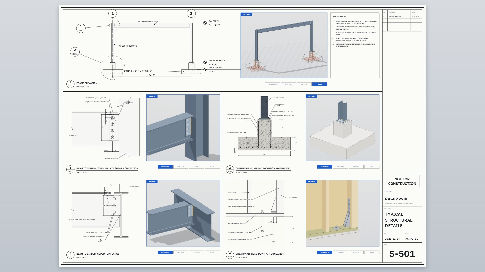
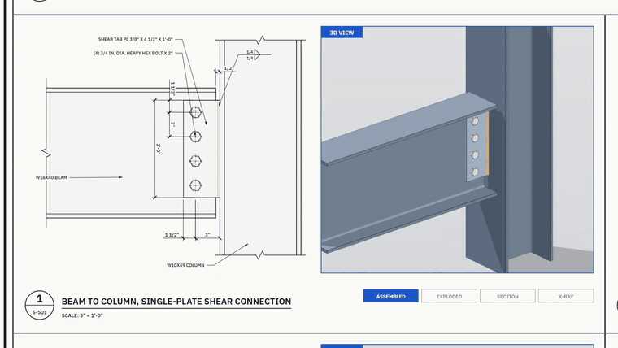

# detail-twin

[](https://dp8l.github.io/detail-twin/)

detail-twin draws structural detail sheets in which every 2D detail sits beside a 3D view of the same model. The sheet keeps the form of a conventional sheet, with a title block, boxed details, number bubbles, detail markers, grid lines, elevation tags, weld symbols and drawing scales. Each detail also carries a 3D view that can be turned, exploded, cut in section and made see-through.

The 2D detail and the 3D view are generated from one model of exact solids, which is built in Python on the build123d and OpenCascade kernel. The dimensions on the sheet are measured from the parts, the callouts are the names and counts of the parts, and the weld sizes are read from the weld parts, so the drawing cannot drift from the model.



## Interactive Sheet

The interactive sheet runs in the browser at [dp8l.github.io/detail-twin](https://dp8l.github.io/detail-twin/), and the same page is `docs/index.html` in the repository. A detail is opened with a click and its 3D view is turned by dragging. The four buttons under the view switch between the assembled, exploded, section and x-ray states. The paper is panned by dragging and zoomed with the scroll wheel, and a double click returns to the whole sheet.

## Detail Sheet

The sample sheet is drawn on a 42 x 30 in. sheet at true drawing scales and holds five details.

| Detail | Scale | Content |
|---|---|---|
| A, frame elevation | 3/8" = 1'-0" | One-bay frame with grid lines, elevation tags and the markers of details 1 and 2 |
| 1, beam to column | 3" = 1'-0" | Single-plate shear connection with bolts, a weld symbol and bolt centre marks |
| 2, column base | 1" = 1'-0" | Section through a spread footing and pedestal with the bar cage, anchor rods and base plate |
| 3, beam to girder | 3" = 1'-0" | Coped beam with a single-plate connection to the girder web |
| 4, shear wall hold-down | 3" = 1'-0" | Wood shear wall end with a hold-down, sill anchors and sheathing nails |

## Model and Checks

A detail is a Python file that builds an assembly of solids in inches. Every part carries a mark, a material class, its properties and the source of its dimensions. The build measures a set of checks on the solids before any file is written, which covers fit-up gaps, bar cover, bar seating, hole clearance, weight per foot against the shape table, and interference between every pair of parts. The same build writes STEP and IFC4 files in true millimetres, and the test suite plants faults that each check is required to catch.

## Quick Start

```bash
uv venv --python 3.12 .venv
uv pip install --python .venv/Scripts/python.exe -e ".[dev]"      # .venv/bin/python on Linux and macOS
.venv/Scripts/python.exe tools/build.py                           # five details, their checks, STEP and IFC in out/
.venv/Scripts/python.exe tools/make_sheet_page.py                 # the interactive sheet, out/living_sheet_preview.html
.venv/Scripts/python.exe tools/make_page.py shear_tab footing holddown portal beam_girder_cope
.venv/Scripts/python.exe -m pytest -q
```

The three W shapes of the samples are shipped with the package. Any other W shape is read from an AISC shapes database spreadsheet, whose path is given in the environment variable `DETAILTWIN_AISC_XLSX`.

## New Details

A new detail is written as a case file in `cases/`, and `cases/beam_girder_cope.py` with its test file is the pattern to copy. The library is described on one page in `skill/references/api.md`. The sheet layout, the drawing view and scale of each detail, and the position of each label are set in `sheet/sheet.js`.

## Claude Code Skill

The folder `skill/` holds the detail-twin skill for Claude Code. With the skill installed, a detail is requested in plain words, and the agent writes the case, runs the checks, looks at the pictures and returns the files with every check listed. The skill is installed by copying the folder to `~/.claude/skills/detail-twin`.

## Limits

- The sample details are geometry. No member or connection was designed for load, and the sheet is marked not for construction.
- Fastener, bar and lumber sizes in the samples were entered by hand and are marked `HAND` in `catalog.py` until sourced tables replace them.
- No code check is made. Edge distances, covers, bend diameters and development lengths are inputs.
- The 2D details are the model drawn as line work, without hidden lines or section marks.
- Threads are drawn as grooves and bar deformations are not modelled.
- The sheet is defined in code for the five samples. A sheet description file is the next step.

## Built On

The solids are built with build123d on OpenCascade, the IFC files are written with IfcOpenShell, and the 3D views are drawn with three.js. The `cad` command of text-to-cad is used for an independent interference check and for hidden-line views.

## License

detail-twin is released under the MIT license, and the full text is in the file `LICENSE`.
